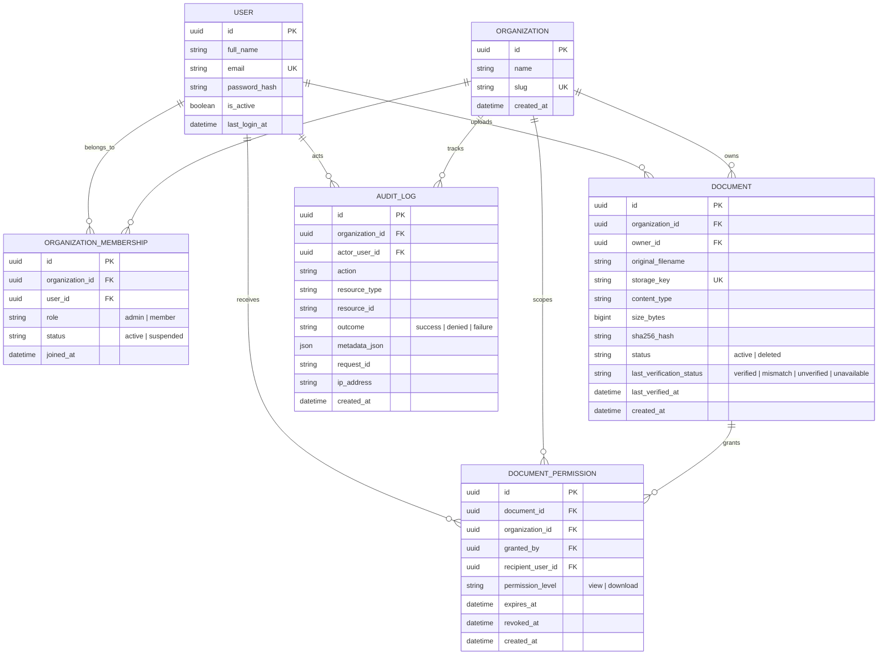
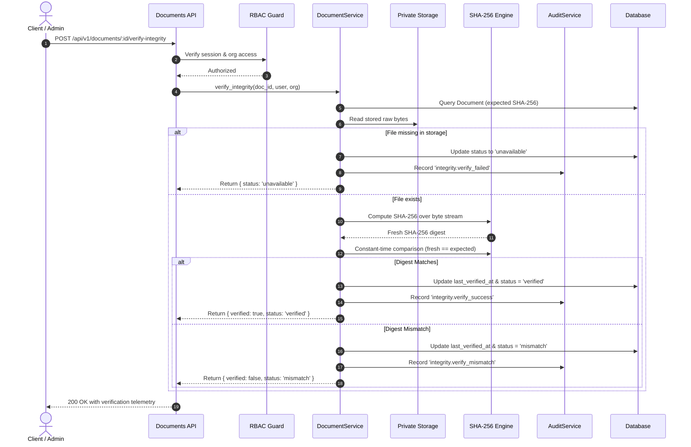

# TrustVault — Architecture & System Design

## 1. System Overview

**TrustVault** is an enterprise-grade multi-tenant secure document management and audit platform built with a **Forward Deployed Engineer (FDE)** mindset. It solves the critical enterprise challenge of managing confidential documents, enforcing non-negotiable role-based access controls (RBAC), verifying cryptographic integrity using SHA-256 digests, and maintaining a complete, immutable audit trail of every document lifecycle event.

```
+-------------------------------------------------------------------------+
|                        Browser Client (React 19)                       |
|   Tailwind CSS v4 (Atelier Cobalt) + Radix UI + TanStack Query + Motion  |
+-------------------------------------------------------------------------+
                                    │
                         HTTP/JSON + Cookies (CSRF)
                                    ▼
+-------------------------------------------------------------------------+
|                        API Gateway / Flask 3.0                          |
|         Request ID Tracking • Rate Limiting • Security Headers          |
+-------------------------------------------------------------------------+
       │                             │                            │
       ▼                             ▼                            ▼
+───────────────+           +──────────────────+         +────────────────+
|  Auth Service |           | Document Service |         |  Audit Service |
|  - Argon2id   |           |  - Byte Stream   |         |  - Immutable   |
|  - RBAC Guard |           |  - SHA-256 Engine|         |    Event Logs  |
|  - Session Mgr|           |  - RBAC Enforcer |         |  - Tenant Scope|
+───────────────+           +──────────────────+         +────────────────+
       │                             │                            │
       ▼                             ▼                            ▼
+───────────────────────────────────────────────+        +────────────────+
|           PostgreSQL 16 (or SQLite dev)       |        | Storage Driver |
|  - Organizations  - Users  - Memberships      |        | - Local Private|
|  - Documents      - Permissions - Audit Logs  |        | - S3-Compatible|
+───────────────────────────────────────────────+        +────────────────+
```

---

## 2. Frontend Architecture

### 2.1 Technology Stack & Decisions
- **React 19 & TypeScript (Strict Mode)**: Type safety across all API payloads, component props, and domain entities.
- **Vite 8**: Sub-second Hot Module Replacement (HMR) and optimized Rollup production bundling.
- **Tailwind CSS v4**: Built upon a custom CSS design system using the **Atelier Cobalt** design tokens (Primary `#3155D9`, Background `#FFFFFF`, Warm Background `#FAF9F6`, Surface Blue `#F1F5FF`, Text `#20283B`, Danger `#B94352`, Success `#207B61`).
- **Radix UI**: Unstyled accessible primitives (Dialogs, Dropdowns, Tooltips, Tabs, Avatars) guaranteeing full WCAG 2.1 compliance and keyboard navigation.
- **TanStack Query (React Query v5)**: Server state management with intelligent background revalidation, query invalidation on mutations, and unified loading/error states.
- **Recharts**: Responsive SVG telemetry charts displaying rolling 7-day document upload, sharing, and verification activity.
- **Lucide React**: Clean, lightweight iconography.

### 2.2 Directory Structure
```
frontend/src/
├── app/                  # Application bootstrap, routing, and React Query/Toast providers
├── components/
│   ├── ui/               # Reusable atomic design components (Button, Input, Badge, Dialog, etc.)
│   ├── layout/           # AppShell, Topbar (with 1-click persona switcher), Sidebar, MobileNav
│   └── documents/        # IntegrityBadge, UploadModal, ShareModal, DocumentDetailsModal
├── features/
│   ├── auth/             # LoginPage, RegisterPage
│   ├── dashboard/        # OverviewPage, MetricCard, ActivityChart
│   ├── documents/        # DocumentsPage (Search, filters, table, action menus)
│   ├── sharing/          # SharedWithMePage, PermissionsPage
│   ├── audit/            # AuditCenterPage (Search, action & outcome filters, metadata inspector)
│   ├── members/          # MembersPage (Member directory, role management, invitation dialog)
│   └── settings/         # SettingsPage (Profile, org details, security policy)
├── hooks/                # useAuth, useToast custom hooks
├── lib/                  # Centralized API client, formatters, and utility helpers
└── types/                # Strongly-typed TypeScript interfaces
```

---

## 3. Backend Architecture

### 3.1 Layered Separation of Concerns
The backend follows a strict multi-tier architecture ensuring zero coupling between HTTP routing, business domain logic, and persistence layers:
1. **Routes Layer (`backend/app/routes/`)**: Validates query/body parameters, extracts session context, delegates to service classes, and serializes responses.
2. **Security & Authorization Layer (`backend/app/security/`)**:
   - `authorization.py`: Decorators (`@login_required`, `@admin_required`) enforcing organization membership, active status, and role authority.
   - `hashing.py`: Argon2id password hashing parameters tuned to OWASP recommendations.
   - `sanitization.py`: Safe filename generator, UUID opaque storage keys, path-traversal prevention, and MIME magic byte validation.
3. **Service Layer (`backend/app/services/`)**: Encapsulates business logic, database transactions, cryptographic integrity calculations, and audit event generation.
4. **Storage Layer (`backend/app/storage/`)**: Pluggable storage abstraction with `LocalStorage` for zero-configuration private filesystem storage and `S3Storage` for AWS S3 or MinIO.
5. **Persistence Models (`backend/app/models/`)**: Declarative SQLAlchemy models with UUID primary keys, foreign key constraints, composite indexes, and cascade safety.

---

## 4. Multi-Tenant Relational Schema



---

## 5. Cryptographic Document Integrity Flow

Integrity verification is not a static database lookup; it executes a real-time cryptographic audit against stored physical bytes:



---

## 6. Real Data Architecture & Security Guarantees

TrustVault enforces a strict **Real Data Only** policy across all environments:
1. **Zero Mock or Demo Data**:
   - Genuinely empty initial state: New tenants start with zero documents, zero permissions, and zero activity logs.
   - Clean authentic empty states with actionable workflows (e.g., *"No documents yet — Upload your first document to begin managing access and verifying integrity."*).
   - No mock arrays, fallback fixtures, or synthetic trends.
2. **Duplicate Prevention & Idempotency**:
   - **User Registrations**: Normalized emails with DB unique constraint; simultaneous race conditions caught and returned as `409 Conflict`.
   - **Memberships**: Unique constraint on `(organization_id, user_id)` preventing duplicate membership entries.
   - **Document Uploads**: Client-generated `X-Idempotency-Key` persisted in DB with composite index; rapid double-click window (10s) deduplication returning existing document without duplicate storage allocation.
   - **Permission Grants**: Idempotent permission checking reuses active grants with matching roles without duplicating audit events.
3. **Cryptographic Tamper Simulator (`POST /api/v1/documents/:id/simulate-tamper`)**:
   - Flips bits in the physical storage object on disk without touching database metadata.
   - Enables demonstrating how TrustVault immediately catches bit corruption or unauthorized storage manipulation with a clear "Digest Mismatch" alert and audit log entry.
