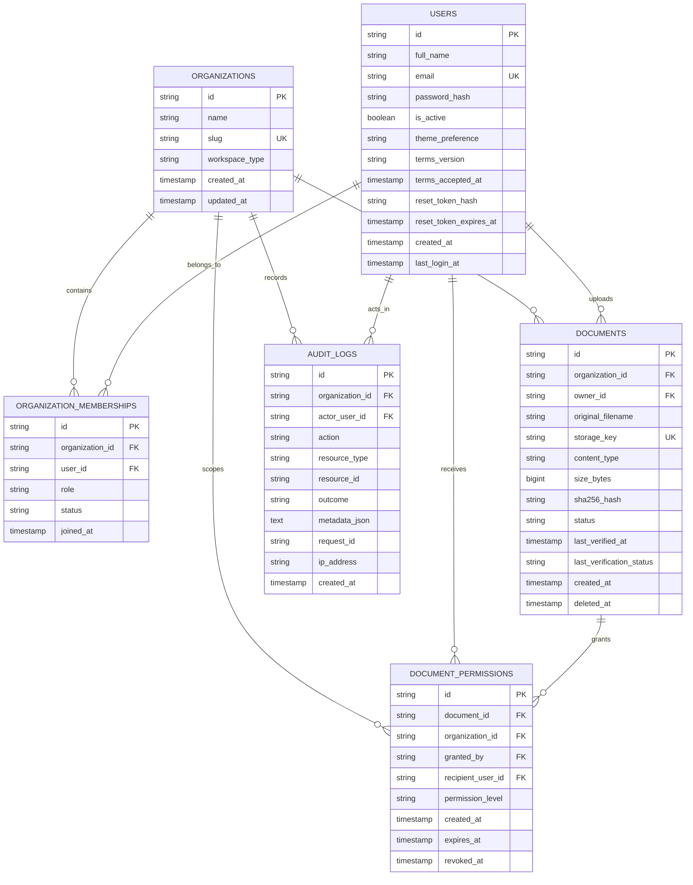

# TrustVault — Relational Database Architecture (`database.md`)

> **Database Engine:** PostgreSQL 16 (Production) / SQLite 3 (Testing & Local Development)  
> **ORM & Migration Framework:** SQLAlchemy 2.0 & Flask-Migrate (Alembic)  
> **Integrity Philosophy:** Real Data Only, Zero-Synthetic Seeds, Database-Enforced Unique Constraints.

---

## 1. Entity-Relationship Diagram (ERD)



---

## 2. Table Specifications & Constraints

### `organizations`
Stores top-level tenant boundaries.
- **`id`** (`VARCHAR(36)`): UUID v4 primary key.
- **`name`** (`VARCHAR(120)`): Display name of the workspace.
- **`slug`** (`VARCHAR(120)`): Unique normalized URL/reference slug.
- **`workspace_type`** (`VARCHAR(20)`): `'personal'` (auto-provisioned for single users) or `'shared'` (team/organization).
- **`created_at` / `updated_at`**: UTC timestamps.
- **Indexes:** `idx_org_slug` on `(slug)`.

### `users`
Stores user identities and authentication security credentials.
- **`id`** (`VARCHAR(36)`): UUID v4 primary key.
- **`full_name`** (`VARCHAR(120)`): User's legal/display name.
- **`email`** (`VARCHAR(255)`): Normalized lowercase unique email address. Enforced by unique index `idx_user_email`.
- **`password_hash`** (`VARCHAR(255)`): Argon2id password hash (`$argon2id$...`).
- **`is_active`** (`BOOLEAN`): Account active flag for suspensions/deactivations.
- **`theme_preference`** (`VARCHAR(20)`): User preference (`'light'`, `'dark'`, `'system'`).
- **`terms_version`** (`VARCHAR(20)`) & **`terms_accepted_at`** (`TIMESTAMP`): Legal compliance audit timestamps.
- **`reset_token_hash`** (`VARCHAR(128)`) & **`reset_token_expires_at`** (`TIMESTAMP`): Single-use password reset credentials.
- **Indexes:** `idx_user_email` on `(email)`.

### `organization_memberships`
Join table establishing tenant association and role-based access.
- **`organization_id`** (`VARCHAR(36)`) REFERENCES `organizations(id)` ON DELETE CASCADE.
- **`user_id`** (`VARCHAR(36)`) REFERENCES `users(id)` ON DELETE CASCADE.
- **`role`** (`VARCHAR(20)`): `'admin'` (full management & audit access) or `'member'` (standard access).
- **`status`** (`VARCHAR(20)`): `'active'` or `'suspended'`.
- **Unique Constraint:** `CONSTRAINT uq_org_user UNIQUE (organization_id, user_id)`. Prevents duplicate memberships.
- **Indexes:** `idx_org_user_role` on `(organization_id, user_id, role)`.

### `documents`
Stores document metadata, opaque storage pointers, and cryptographic digests.
- **`id`** (`VARCHAR(36)`): UUID v4 primary key.
- **`organization_id`** (`VARCHAR(36)`) REFERENCES `organizations(id)` ON DELETE CASCADE.
- **`owner_id`** (`VARCHAR(36)`) REFERENCES `users(id)` ON DELETE RESTRICT.
- **`original_filename`** (`VARCHAR(255)`): Sanitized user filename for display.
- **`storage_key`** (`VARCHAR(512)`): Unique opaque physical storage key (`orgs/{org_id}/{yyyy}/{mm}/{uuid}.bin`). Never exposes real filesystem paths.
- **`content_type`** (`VARCHAR(128)`): MIME type verified by magic header bytes.
- **`size_bytes`** (`BIGINT`): Exact physical size in bytes.
- **`sha256_hash`** (`VARCHAR(64)`): Authoritative SHA-256 hex digest computed server-side from received bytes.
- **`status`** (`VARCHAR(32)`): `'active'` or `'deleted'` (soft delete).
- **`last_verified_at`** & **`last_verification_status`**: Real-time integrity verification audit cache (`'verified'`, `'mismatch'`, `'unavailable'`).
- **Indexes:** `idx_doc_org_created`, `idx_doc_org_owner`, `idx_doc_hash`.

### `document_permissions`
Stores fine-grained access grants between documents and workspace members.
- **`document_id`** (`VARCHAR(36)`) REFERENCES `documents(id)` ON DELETE CASCADE.
- **`organization_id`** (`VARCHAR(36)`) REFERENCES `organizations(id)` ON DELETE CASCADE.
- **`granted_by`** (`VARCHAR(36)`) REFERENCES `users(id)` ON DELETE RESTRICT.
- **`recipient_user_id`** (`VARCHAR(36)`) REFERENCES `users(id)` ON DELETE CASCADE.
- **`permission_level`** (`VARCHAR(20)`): `'view'` (inspect metadata & integrity) or `'download'` (retrieve binary stream).
- **`expires_at`** (`TIMESTAMP`): Optional expiration timestamp.
- **`revoked_at`** (`TIMESTAMP`): Revocation timestamp; when not null, access is denied immediately.
- **Indexes:** `idx_perm_recipient_active` on `(recipient_user_id, revoked_at)`, `idx_perm_doc_active` on `(document_id, revoked_at)`.

### `audit_logs`
Append-only tamper-evident operational security log.
- **`organization_id`** (`VARCHAR(36)`) REFERENCES `organizations(id)` ON DELETE CASCADE.
- **`actor_user_id`** (`VARCHAR(36)`) REFERENCES `users(id)` ON DELETE SET NULL.
- **`action`** (`VARCHAR(64)`): Canonical action (e.g. `auth.login`, `document.upload`, `permission.revoke`, `integrity.verify_mismatch`).
- **`resource_type`** & **`resource_id`**: Affected entity.
- **`outcome`** (`VARCHAR(20)`): `'success'`, `'denied'`, `'failure'`.
- **`metadata_json`** (`TEXT`): Redacted structured metadata payload.
- **`request_id`** (`VARCHAR(48)`): Correlation ID for distributed tracing.
- **`created_at`** (`TIMESTAMP`): Persisted strictly in UTC.
- **Indexes:** `idx_audit_org_created`, `idx_audit_org_action`, `idx_audit_resource`.

---

## 3. Database Migration Procedures

TrustVault uses **Flask-Migrate (Alembic)** for schema versioning:

```bash
# Initialize migration repository (first time)
flask db init

# Generate migration from models
flask db migrate -m "migration_description"

# Apply migrations to database
flask db upgrade
```

### Local Development Quick-Bootstrap
For rapid development on SQLite, `migrate_dev_db.py` executes idempotent schema updates directly:
```bash
cd backend
.\venv\Scripts\python migrate_dev_db.py
```
